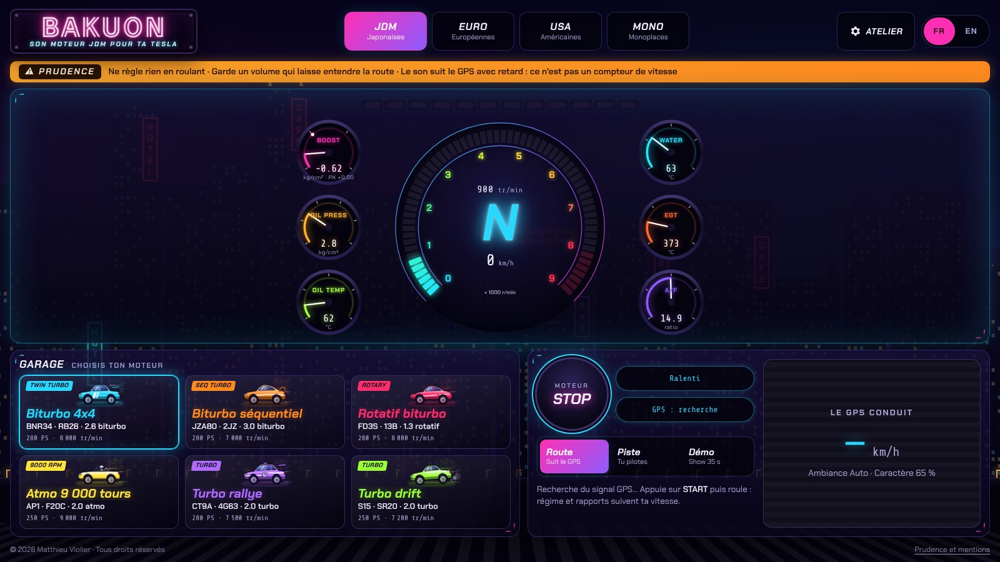
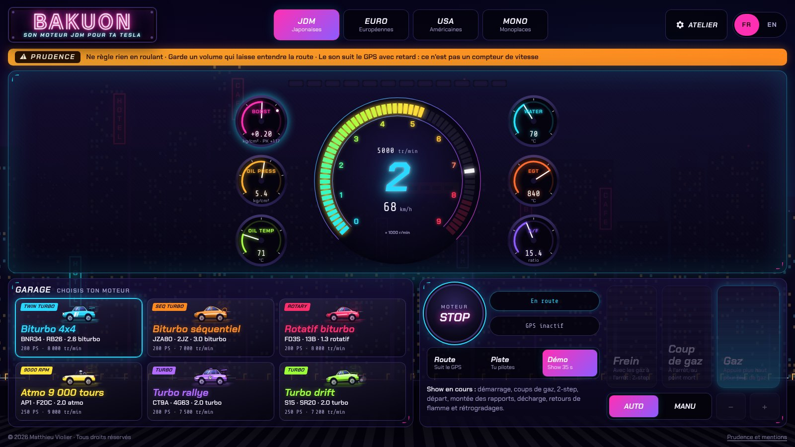
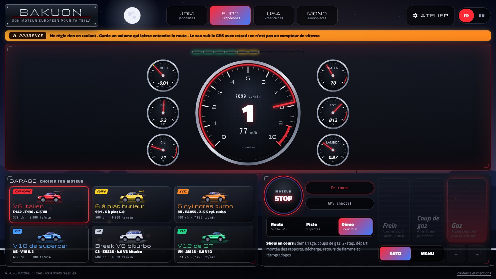
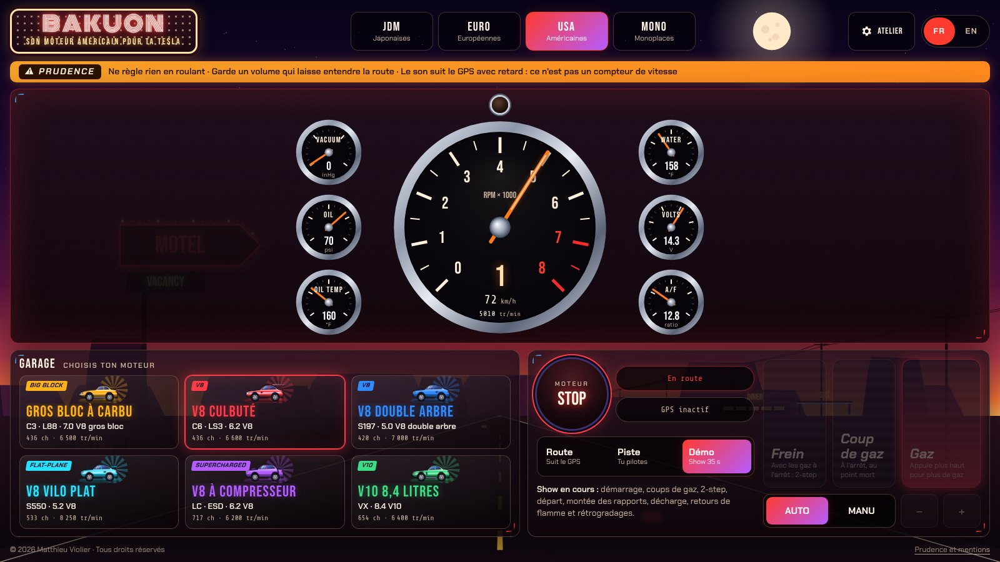
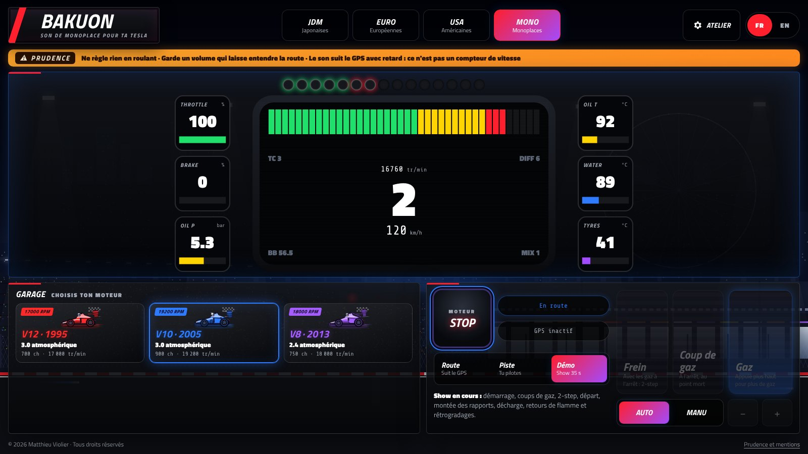

# BAKUON

**Son moteur synthétisé en direct pour le navigateur de la Tesla.** 21 moteurs sur quatre pages (japonaises, européennes, américaines et monoplaces), qui suivent ta vitesse GPS. Aucun enregistrement : tout est calculé en temps réel.

**Essayer :** [matt-v-git.github.io/bakuon](https://matt-v-git.github.io/bakuon/) · **Notice d'utilisation :** [PDF d'une page](docs/notice-bakuon.pdf)

| Japonaises | Européennes |
| --- | --- |
|  |  |
| **Américaines** | **Monoplaces** |
|  |  |

## Ce que ça fait

- **Quatre pages, quatre ambiances.** Tokyo au néon, col de montagne au crépuscule, route du désert, circuit de nuit. Chaque page a son enseigne, son compte-tours et ses miniatures, avec une transition animée entre les pages. Le même écran dans les trois modes : bandeau de prudence, combiné (compte-tours entouré de six manos : turbo, huile, eau, échappement, richesse), garage et commandes.
- **Synthèse physique du son.** Explosions cylindre par cylindre dans l'ordre d'allumage réel, collecteurs et lignes d'échappement simulés, turbo, compresseur, flutter, blow-off, retours de flamme, anti-lag, 2-step, distribution variable.
- **Mode Route.** Régime et rapports suivent la vitesse GPS, avec une prédiction qui compense le retard du GPS. L'ambiance Ville, Route ou Auto choisit des rapports courts ou réels, et le caractère (de Sage à Spectacle) règle le surrégime et les rétrogradages quand tu accélères fort.
- **Modes Piste et Démo** sans GPS, avec pédales à l'écran.
- **Fait pour l'écran de la Tesla.** Tout tient dans la fenêtre sans défilement, son voicé pour les haut-parleurs de la voiture, interface en français ou en anglais.

## Utilisation dans la Tesla

1. Voiture à l'arrêt, ouvre le navigateur sur [matt-v-git.github.io/bakuon](https://matt-v-git.github.io/bakuon/).
2. Lis et valide l'avertissement de prudence, puis autorise la localisation.
3. Choisis ta page (JDM, EURO, USA, MONO) et ton moteur (**Changer de moteur**), puis appuie sur **START**.
4. Les réglages (volume, ambiance, caractère, décharge turbo, retours de flamme, point d'écoute…) sont dans l'**Atelier**.

Chaque page a son adresse : `#jdm`, `#euro`, `#usa`, `#mono`.

## Technique

React 19 · TypeScript (strict) · Vite · WebAssembly (AssemblyScript) · Web Audio API (AudioWorklet) · Canvas 2D · Vitest

Le moteur sonore est un module WebAssembly qui tourne sur le fil audio du navigateur. Les compteurs sont dessinés en canvas par une boucle d'animation qui lit directement la simulation : React gère la structure, jamais les mises à jour à 60 images par seconde. Détails dans [docs/ARCHITECTURE.md](docs/ARCHITECTURE.md).

Ce dépôt est la vitrine du projet : il contient le site compilé (`site/`), la documentation et les captures. **Le code source est privé** et peut être présenté sur demande.

## Prudence et mentions

Règle tout à l'arrêt ou laisse un passager le faire, et garde un volume qui laisse entendre la route. Le son suit le GPS avec un peu de retard : ce n'est pas un compteur de vitesse.

Projet indépendant, sans lien avec Tesla ni avec aucun constructeur. Tesla est une marque de Tesla, Inc., citée uniquement pour indiquer la compatibilité. Seuls des codes techniques de moteurs et de châssis sont cités, à titre descriptif ; les silhouettes sont des dessins génériques.

© 2026 Matthieu Violier. Tous droits réservés (voir [LICENSE](LICENSE)). Polices sous licence SIL Open Font License 1.1.
