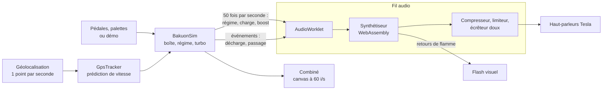

# Architecture de BAKUON

BAKUON synthétise en temps réel le son d'un moteur thermique dans le navigateur de la Tesla. Aucun enregistrement : chaque explosion, chaque retour de flamme et chaque sifflement de turbo est calculé échantillon par échantillon.

## Vue d'ensemble

| Dossier | Rôle |
| --- | --- |
| `assembly` | Le synthétiseur, écrit en AssemblyScript et compilé en WebAssembly |
| `src/audio` | Pilotage du module WebAssembly (`voice.ts`), processeur AudioWorklet (`worklet.ts`), chaîne de sortie (`engine.ts`), rendu hors ligne pour les tests (`offline.ts`) |
| `src/data` | Les 21 moteurs (rapports, régimes, turbo ou compresseur) et leurs réglages sonores, typés |
| `src/sim` | Simulation de conduite (`sim.ts`) et suivi de vitesse GPS (`gps.ts`) |
| `src/core` | Préférences persistées (`store.ts`) et contrôleur qui relie simulation, audio et GPS (`rig.ts`) |
| `src/render` | Dessin canvas : décors (`scenes.ts`), compteurs par page (`gauges.ts`), miniatures SVG (`art.ts`) |
| `src/ui` | Composants React : scène, barre du haut, combiné, commandes, bande des moteurs, atelier, avertissement |
| `tests` | Tests Vitest : simulation, GPS, synthèse audio, textes |

## Le moteur sonore

Le synthétiseur est un modèle physique simplifié :

1. **Combustion.** Chaque cylindre émet une impulsion de pression (double exponentielle) au moment exact de son allumage, selon l'ordre d'allumage réel. L'amplitude dépend de la charge, du boost, d'un léger défaut propre à chaque cylindre et d'une variation aléatoire à chaque cycle.
2. **Collecteur.** Chaque impulsion traverse un guide d'onde (une ligne à retard avec réflexion amortie) dont la longueur est celle du tube primaire.
3. **Deux lignes d'échappement.** Les cylindres alimentent la ligne gauche ou droite selon leur rangée. C'est ce qui donne naturellement le glouglou irrégulier d'un V8 à vilebrequin croisé et le hurlement régulier d'un vilebrequin plat, sans aucun effet ajouté.
4. **Silencieux et caisse.** Un filtre passe-bas réglable et une résonance basse imitent le silencieux et la caisse.
5. **Habillage.** Admission (et came haute de la distribution variable), sifflement de turbo, compresseur volumétrique, sifflement de pignons, flutter, blow-off, retours de flamme, anti-lag, claquement de boîte séquentielle, démarreur.
6. **Voix « enceintes de voiture ».** Le grave sous 50 Hz est coupé, le médium boueux autour de 240 Hz est aminci et la présence autour de 2 kHz est relevée. Sans ce traitement, le système audio Tesla rendait le son étouffé.

Les monoplaces ajoutent trois paramètres : une saturation asymétrique des pulsations (chaleur), un bruit turbulent porté par chaque explosion (raucité) et un fort désaccord entre cylindres (grognement des demi-ordres sous le hurlement). Leur boîte de course coupe l'allumage un instant à chaque montée, donne un coup de gaz automatique à chaque rétrogradage, enchaîne les rapports en un cinquième de seconde et claque à chaque passage.

Chaque moteur a sa signature, réglée d'après ses particularités réelles et vérifiée par mesure (spectre par tiers d'octave, irrégularité, demi-ordres) pour que deux moteurs d'une même page ne se ressemblent pas : allumage irrégulier à 54° et 90° du V10 culbuté, glouglou du 5 cylindres (allumage tous les 144°), came pointue du gros bloc à carburateur, rotatif rauque et saturé, sifflement de distribution du 4 cylindres atmosphérique et du V8 double arbre, sifflement du compresseur volumétrique.

**Compilé en WebAssembly.** Le synthétiseur est écrit en AssemblyScript (`assembly/dsp.ts`) et compilé en un module WebAssembly de 35 Ko. Il ne fait aucune allocation après le démarrage : la page écrit la description du moteur dans sa mémoire, lui envoie l'état de la simulation et récupère les échantillons. Par rapport à la première version en TypeScript, le rendu est identique échantillon par échantillon et deux fois plus rapide.

Le module tourne dans un **AudioWorklet**, sur le fil audio du navigateur, pour ne jamais être interrompu par l'affichage. Le worklet reçoit les octets du module, le compile lui-même et rejoue les messages arrivés pendant la compilation. Si l'AudioWorklet manque, le même module tourne dans un ScriptProcessor. Le même module tourne aussi dans Node pour les tests.

## La simulation

`BakuonSim` avance 50 fois par seconde : démarrage, ralenti, embrayage au départ, boîte automatique (avec réglage du style de conduite) ou manuelle, rupteur, 2-step, bridage de vitesse par page, montée et chute du turbo, compresseur proportionnel au régime.

**Le mode Route.** Avec les vrais rapports, une Tesla reste en 2e jusqu'à 70 km/h et le régime ne fait que recopier la vitesse. La boîte de route travaille donc sur une vitesse « virtuelle » : environ le double de la vraie en ville, puis de moins en moins avec la vitesse (ambiance Auto), toujours croissante pour que le régime ne baisse jamais pendant une accélération. L'ambiance Ville garde des rapports courts partout, l'ambiance Route les vrais rapports. Elle choisit ses rapports pour tenir le moteur dans une plage de croisière : pour un moteur qui monte à 8 000 tr/min, Caractère au milieu, de 2 500 à 3 500 tr/min en ville et de 3 000 à 4 000 sur route, jusqu'à environ 5 800 sur une accélération franche. Un rapport n'est passé que s'il ne fait pas tomber le régime sous la plage, ce qui évite les allers-retours. Comme le navigateur ne peut pas lire la pédale, l'accélération mesurée par le GPS sert de pédale : conduite cool, passages tôt ; accélération franche, rétrogradage d'un ou deux rapports et surrégime ; décélération, rétrogradages avec coup de gaz et retours de flamme. Le curseur Caractère (de Sage à Spectacle) déplace toute la plage : plus bas et sans surrégime en Sage, jusqu'au rupteur avec rétrogradages appuyés en Spectacle. La vitesse affichée reste la vraie.

En mode Route, la vitesse vient du GPS. Le navigateur ne donne qu'environ un point par seconde, avec du retard. `GpsTracker` estime donc l'accélération à partir des derniers points, projette la vitesse jusqu'à l'instant présent (retard compris) et la suit avec un lissage court de 0,18 s. Sur un flux à 1 Hz avec 0,4 s de latence, l'erreur moyenne de vitesse passe d'environ 2 m/s (première version) à moins de 1 m/s.

## L'affichage

- **Une scène à taille fixe mise à l'échelle.** L'interface est dessinée pour trois formats (1600 × 900, 1280 × 960 pour le navigateur Tesla à côté de la carte, 800 × 1600 pour les téléphones) puis mise à l'échelle de la fenêtre. Rien ne défile, et les cadres gardent la même taille et la même place sur les quatre pages : seuls les couleurs, les polices et le dessin des compteurs changent.
- **Le même écran dans les trois modes.** Un bandeau de prudence permanent, le combiné sur toute la première ligne (le compte-tours au centre, entouré de six manos : pression de turbo, pression et température d'huile, température d'eau, température d'échappement, richesse), puis les commandes à gauche, au plus près du conducteur, et le garage à droite. Seule une partie des commandes change : pédales et boîte en Piste et en Démo, panneau GPS en Route. Les cadres et les boutons gardent la même taille d'un mode à l'autre.
- **Un combiné qui remplit l'écran.** La place des cadrans est calculée une fois par format (`src/render/layout.ts`) : le compte-tours prend toute la hauteur, et de chaque côté les manos du haut et du bas se logent dans les coins laissés libres par le cadran rond, celui du milieu un peu plus loin, en arc. Derrière les cadrans, chaque page dessine son panneau : rien sur la page JDM (néon), carbone verni sur la page EURO, aluminium bouchonné et cadrans crème sur la page USA, volant complet avec poignées, molettes et petits écrans sur la page MONO.
- **React pour la structure, canvas pour le temps réel.** Les composants React gèrent la mise en page, les réglages et le changement de page. Le compte-tours, les six manos et le décor sont dessinés dans des canvas par une boucle `requestAnimationFrame` qui lit directement l'état de la simulation et écrit les valeurs dans le DOM. Ces mises à jour à 60 images par seconde ne passent jamais par le rendu React.
- **Le décor suit l'interface.** La lune des pages EURO et USA se place dans l'espace libre de la barre du haut, mesuré sur la mise en page réelle, pour ne jamais passer derrière un bouton.
- **Préférences** dans un petit store externe (`useSyncExternalStore`), sauvegardé dans `localStorage`.

## Protection du code

- Le code source est dans un dépôt privé. Le dépôt public ne contient que le site compilé, cette documentation et les captures.
- Le synthétiseur, cœur du projet, est livré en WebAssembly binaire.
- Le reste du code est brouillé à chaque construction (noms, textes et flux de contrôle), avec des réglages légers pour garder 60 images par seconde. React reste dans un fichier à part, non brouillé.
- Chaque fichier commence par la mention de droits d'auteur.

## Règles de conception

- Chaque page a son style : néon JDM, chrome et carbone européens, bord de route américain, écran de volant de monoplace. Aucun texte en japonais : l'interface est en français ou en anglais.
- Aucun logo, aucune carrosserie réelle, aucune marque déposée affichée : des silhouettes génériques et seulement des codes techniques de moteurs et de châssis, à titre descriptif. Tesla n'est citée que pour indiquer la compatibilité.
- Les flashs visuels restent à trois par seconde au maximum et sont coupés en mode Route (GPS), qui est le mode par défaut.
- L'avertissement de prudence s'affiche à chaque ouverture et doit être validé avant de pouvoir démarrer.

## Qualité

- `npm test` compile le synthétiseur puis lance 65 tests : simulation (démarrage, boîte, 2-step, turbo, compresseur, conduite en mode Route à partir de points GPS avec les plages de régime et l'effet du Caractère, boîte de course des monoplaces), suivi GPS (mesure, latence, absence d'à-coups), synthèse de la démo complète de chaque moteur (aucune valeur invalide, pas d'écrêtage, niveaux homogènes d'un moteur à l'autre), parité des textes français et anglais, noms de moteurs courts, et aucune marque ni série dans les textes, l'en-tête de la page et les documents publics.
- `npm run build` vérifie aussi les types TypeScript (mode strict).
- La publication passe par `scripts/publish.sh` : tests, construction protégée, puis envoi du site compilé dans le dépôt public, que GitHub Actions publie sur GitHub Pages.
